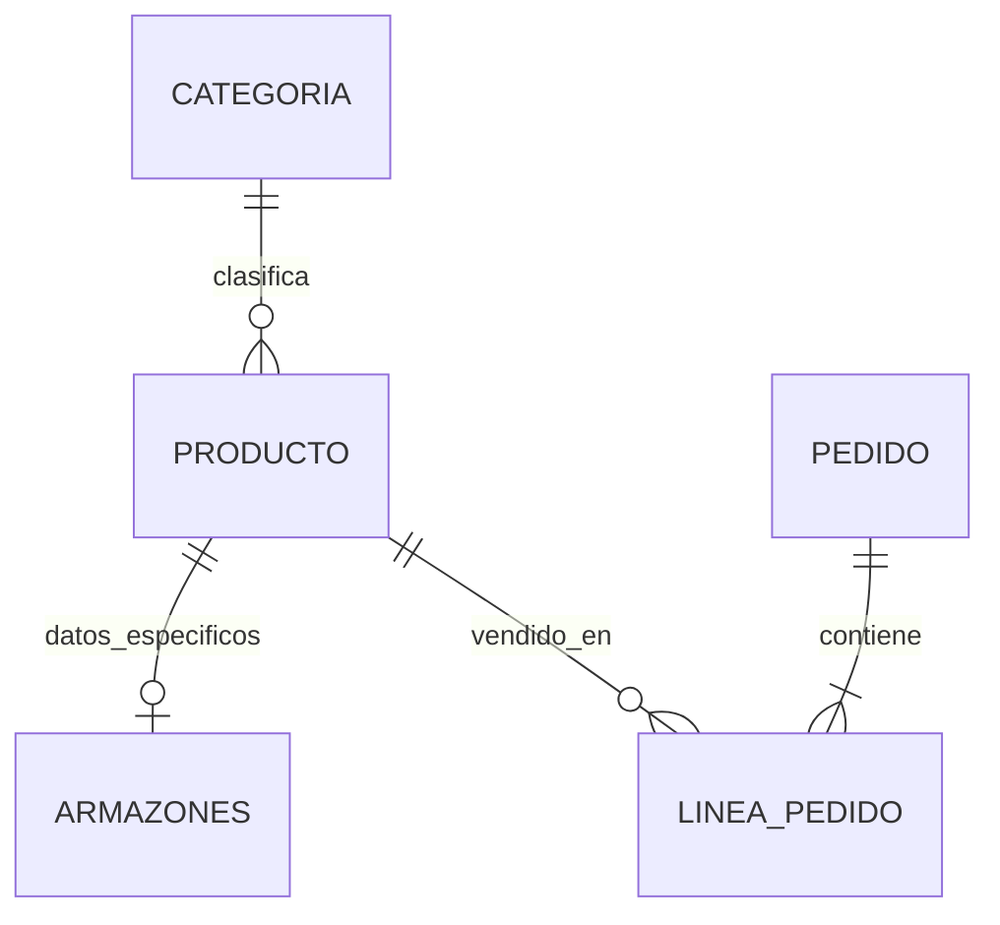

# Optic Choices — Proyecto final de Java

Aplicación de catálogo y gestión de productos ópticos, con carrito de compras, backend REST en Spring Boot y persistencia en MySQL. Incluye un panel de administración basado en el diseño del proyecto frontend original.

> **Estado de este documento:** 26 de noviembre de 2026. Registra las funciones comprobadas durante el desarrollo y distingue las integraciones todavía pendientes. Actualizarlo al finalizar la entrega.

## Tecnologías

| Capa | Tecnología |
| --- | --- |
| Backend | Java 21, Spring Boot 4, Spring Web, Spring Data JPA |
| Seguridad | Spring Security, autenticación mediante JWT y rol `ADMIN` |
| Base de datos | MySQL 8 |
| Frontend | HTML, CSS y JavaScript (sin React) |
| Entorno de desarrollo | VS Code, Maven Wrapper, MySQL Workbench / HeidiSQL, Live Server |

## Organización del proyecto

```text
Proyecto_Java/
├── optica_backend/
│   ├── pom.xml
│   ├── mvnw.cmd
│   └── src/main/
│       ├── java/com/talentotech/optica_backend/
│       │   ├── model/        # Producto, Armazones, Categoria, Pedido, LineaPedido, etc.
│       │   ├── repository/   # Acceso a MySQL mediante JPA
│       │   ├── service/      # Reglas de negocio
│       │   ├── controller/   # Endpoints REST
│       │   ├── dto/          # Datos de entrada/salida
│       │   └── config/       # CORS, seguridad y JWT
│       └── resources/application.properties
├── optica_frontend/
│   ├── index.html           # Catálogo y carrito
│   ├── script.js
│   ├── style.css
│   ├── admin.html           # Gestión del catálogo
│   ├── admin.js
│   ├── admin.css
│   └── pictures/            # Imágenes locales de productos
└── README.md
```

*La estructura indica la organización lógica de los archivos; comprobar la ubicación exacta de cada clase antes de entregar.*

## Base de datos

Se utiliza el esquema `optica`. Las tablas de negocio y sus relaciones son:

| Tabla | Propósito | Campos principales |
| --- | --- | --- |
| `categoria` | Clasifica los productos | `id` (PK), `nombre` |
| `producto` | Catálogo y existencias | `id` (PK), `nombre`, `descripcion`, `precio`, `stock`, `categoria_id` (FK), `ruta_imagen` |
| `armazones` | Dimensiones de armazones | `id` (PK y FK a `producto.id`), `ancho_frente`, `largo_patilla`, `ancho_cristal`, `alto_cristal` |
| `pedido` | Encabezado de cada compra | `id` (PK), `usuario`, `email`, `fecha`, `total` |
| `linea_pedido` | Detalle de artículos comprados | `id` (PK), `pedido_id` (FK), `producto_id` (FK), `cantidad`, `precio_unitario`, `subtotal` |

Relaciones:

- Una categoría puede tener muchos productos (`categoria` → `producto`).
- Un producto puede tener datos de armazón en la tabla especializada `armazones` (herencia JPA `JOINED`).
- Un pedido contiene muchas líneas (`pedido` → `linea_pedido`).
- Cada línea apunta al producto comprado y conserva el **precio unitario al momento de la compra**, para no alterar el historial si cambia el precio del catálogo.



**Nota:** actualmente la cuenta administradora se configura con variables de entorno, **no hay todavía una tabla de usuarios**. Crear esa tabla y adaptar la autenticación es una tarea pendiente.

### Consultas de verificación en Workbench

```sql
USE optica;
SHOW TABLES;

SELECT id, nombre, precio, stock, categoria_id
FROM producto ORDER BY id;

SELECT id, usuario, email, fecha, total
FROM pedido ORDER BY id DESC;

SELECT id, pedido_id, producto_id, cantidad, precio_unitario, subtotal
FROM linea_pedido ORDER BY id DESC;
```

> Para permitir la instalación en otra computadora, todavía conviene **exportar desde Workbench un `.sql` con estructura y datos de ejemplo** y agregar instrucciones para importarlo. Las definiciones anteriores describen la estructura utilizada, pero no sustituyen el respaldo SQL real.

## Instalación y ejecución local (Windows / PowerShell)

### Requisitos

- JDK 21 y MySQL Server 8 en funcionamiento.
- Maven Wrapper incluido en `optica-backend`.
- Un servidor local para `optica-frontend` (por ejemplo, Live Server de VS Code).
- Base de datos `optica` ya creada e inicializada con las tablas y productos.

### Variables de entorno

En la **misma terminal de PowerShell** desde la que se iniciará Spring Boot:

```powershell
# Contraseña de conexión a MySQL
$db = Read-Host "Contraseña de MySQL" -AsSecureString
$env:DB_PASSWORD = [System.Net.NetworkCredential]::new("", $db).Password
Remove-Variable db

# Credenciales de administrador (versión actual, sin tabla de usuarios)
$env:OPTICA_ADMIN_USER = "admin"
$admin = Read-Host "Contraseña del administrador" -AsSecureString
$env:OPTICA_ADMIN_PASSWORD = [System.Net.NetworkCredential]::new("", $admin).Password
Remove-Variable admin

# Clave de firma JWT (32 bytes aleatorios, codificados en Base64)
$bytes = New-Object byte[] 32
$rng = [System.Security.Cryptography.RandomNumberGenerator]::Create()
$rng.GetBytes($bytes)
$rng.Dispose()
$env:JWT_SECRET = [Convert]::ToBase64String($bytes)
Remove-Variable bytes, rng

# Verificar existencia sin imprimir secretos
"DB_PASSWORD", "OPTICA_ADMIN_USER", "OPTICA_ADMIN_PASSWORD", "JWT_SECRET" |
    ForEach-Object { "${_}: $(Test-Path "Env:$_")" }
```

No almacenar contraseñas ni `JWT_SECRET` en archivos versionados. Una clave JWT recién generada invalida los tokens firmados con una clave anterior. Las variables `$env:` de PowerShell no persisten al cerrar la terminal.

### Iniciar el backend

```powershell
cd optica-backend
.\mvnw.cmd clean compile
.\mvnw.cmd spring-boot:run
```

Backend esperado en `http://localhost:8081`. La conexión JDBC y la variable `${DB_PASSWORD}` se configuran en `application.properties`.

### Iniciar el frontend

Abrir `optica-frontend/index.html` mediante Live Server, generalmente en `http://127.0.0.1:5500/` (o `http://localhost:5500/`). Acceder al panel desde el enlace **Administrar catálogo**; `admin.html` permite regresar a la tienda.

CORS debe autorizar el origen utilizado por Live Server y las rutas de la API (incluido `/auth/login`).

## Endpoints REST

| Método | Ruta | Función | Acceso previsto |
| --- | --- | --- | --- |
| `GET` | `/productos` | Listar productos | Público |
| `GET` | `/productos/{id}` | Consultar producto | Público |
| `GET` | `/productos?nombre=texto` | Buscar por nombre | Público |
| `POST` | `/productos` | Agregar producto | `ADMIN` + JWT |
| `PUT` | `/productos/{id}` | Actualizar atributos | `ADMIN` + JWT |
| `DELETE` | `/productos/{id}` | Eliminar producto | `ADMIN` + JWT |
| `POST` | `/pedidos` | Crear pedido, registrar líneas y descontar stock | Público en la configuración actual |
| `POST` | `/auth/login` | Validar administrador y emitir JWT | Público |

### Alta y edición de productos

Las operaciones de alta y modificación reciben, entre otros, los siguientes campos:

```json
{
  "nombre": "Producto de ejemplo",
  "descripcion": "Descripción del producto",
  "precio": 25000.00,
  "stock": 5,
  "categoriaId": 1,
  "rutaImagen": "./pictures/ejemplo.jpg"
}
```

El alta admite opcionalmente un objeto `medidas`, con `anchoFrente`, `largoPatilla`, `anchoCristal` y `altoCristal`. **El formulario de administración todavía no envía esas medidas**: por ahora puede crear productos genéricos.

**Imágenes:** el campo `rutaImagen` conserva una ruta de imagen, no sube un archivo al servidor. Para visualizar una imagen nueva, esta debe existir en una ubicación accesible desde el frontend.

### Inicio de sesión y autorización

Solicitud:

```http
POST /auth/login
Content-Type: application/json

{"usuario":"admin","clave":"<contraseña ingresada localmente>"}
```

Respuesta exitosa: un JSON con `token` y `tipo` (`Bearer`). Para operaciones administrativas:

```http
Authorization: Bearer <token JWT>
```

El backend verifica el token y el rol `ADMIN`. La cuenta administradora actual se define mediante variables de entorno; se planea reemplazarla o complementarla con usuarios persistidos en MySQL.

### Registro de pedidos

Ejemplo de solicitud a `POST /pedidos`:

```json
{
  "usuario": "Cliente de prueba",
  "email": "cliente@ejemplo.com",
  "lineas": [
    {"productoId": 1, "cantidad": 2},
    {"productoId": 3, "cantidad": 1}
  ]
}
```

El backend obtiene los precios de MySQL, valida cantidades y stock, calcula el total y registra el pedido y sus líneas dentro de una transacción. **El carrito del frontend todavía no envía la confirmación de compra a este endpoint.**

## Estado de avance (26/11/2026)

| Funcionalidad | Estado |
| --- | --- |
| API de productos + MySQL | Implementada y probada |
| Catálogo visual con imágenes, categorías y búsqueda | Implementado |
| Carrito, control visual de cantidades y total | Implementado en frontend |
| Creación de pedidos y descuento de stock en backend | Probados con solicitud HTTP y en Workbench |
| Panel de administración: iniciar sesión JWT | Probado desde navegador |
| Panel de administración: alta de productos con JWT | Probada |
| Panel de administración: eliminación de productos con JWT | Probada |
| Panel de administración: modificación con JWT | Código conectado; resta repetir la prueba autenticada |
| Compra desde carrito (`POST /pedidos`) | Pendiente |
| Usuarios persistidos en MySQL | Pendiente |
| Carga de medidas de nuevos armazones desde `admin.html` | Pendiente |
| Exportación de esquema/datos SQL y revisión de README | Pendiente |

## Próximas tareas

- [ ] Crear tabla/entidad de usuarios, repositorio y autenticación asociada a la base de datos; almacenar contraseñas con hash seguro, no en texto plano.
- [ ] Conectar el botón de confirmación del carrito a `POST /pedidos`. Vaciar el carrito **solo si el backend confirma la compra** y refrescar existencias desde la API.
- [ ] Reprobar `PUT /productos/{id}` desde el panel usando JWT.
- [ ] Incorporar las cuatro medidas de armazones en el formulario de alta si alcanza el tiempo.
- [ ] Exportar un script SQL reproducible, revisar los endpoints y hacer pruebas finales de permisos y errores.
- [ ] Actualizar este documento para reflejar el resultado final.

## Consideraciones

- Un producto incluido en pedidos previos puede no poder eliminarse debido a las claves foráneas; es preferible conservar el historial de compras.
- Los controles visuales de stock del carrito no reemplazan la validación real del backend.
- El proyecto utiliza JWT para las operaciones administrativas: la autorización real se hace en Spring Security, no ocultando botones con JavaScript.
- Este es un proyecto académico en desarrollo; no incorpora todavía una pasarela de pagos ni un sistema de compras listo para producción.
